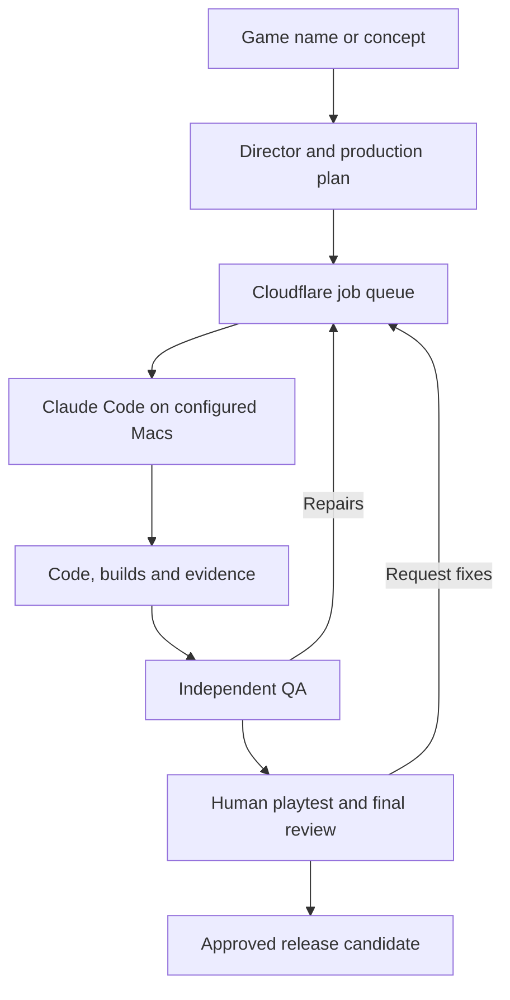

# SaneGames · Autonomous Game Studio

A Claude-driven production framework for original, approachable, feel-good mobile games. Give the studio a game name or concept; its agents research, design, plan, implement, review and repair the work. Humans provide real playtesting and the final review of exact Android/iOS builds.

**Start here:** [Studio launch prompt](prom.md) · [Start a game](docs/START_A_GAME.md) · [29 agent contracts](agents/README.md) · [Technology](docs/TECH_STACK.md) · [Worker setup](docs/WORKER_SETUP.md) · [Track Claude’s work](docs/CLAUDE_DASHBOARD_WORKFLOW.md) · [500 game references](research/CATALOG_500.md)

The framework coordinates work through a Cloudflare dashboard and runs Claude Code/build tools on the studio's Macs. Source code and local tests do not mean the live dashboard has deployed this revision or that workers are connected. The dashboard reports those states separately.

## Give Claude one assignment

Open a checkout with configured Claude Code access, then ask:

> Read prom.md completely. Build an original, happy petrol-station management game. Use the studio organization, save checkpoints, and continue through implementation and independent QA. Prepare both mobile builds and launch materials for my final dashboard review.

You can give an original concept, a working title, or a reference game. Agents must create original code, content, visuals and branding. A reference is not permission to copy a competitor's product.

The launch prompt explains role routing, repository creation, design decisions, tasks, execution, rework, evidence and final review. Routine concept, art, architecture and implementation decisions stay with agents. Missing account access, legal identity, device access or unavailable tools remain real setup dependencies.

## What the framework includes

| Capability | Repository implementation |
|---|---|
| Studio organization | 29 detailed `agents/<role>/prom.md` contracts, explicit ownership, outputs, acceptance checks and continuity. |
| Claude entrypoints | Generated `.claude/agents` definitions, a canonical registry, shared rules and drift validation. |
| Game-name kickoff | Local planning/bootstrap and configured private-repository/dashboard kickoff tooling. |
| Cloud coordination | Durable jobs, dependencies, idempotency, bounded retries, expiring repository leases and fencing. |
| Worker execution | Opt-in subscription CLI runner, repository checks, isolated candidates, structured results and private artifacts. |
| Operations dashboard | [Studio interface](docs/DASHBOARD_DESIGN.md), worker freshness, job states, task creation, evidence inspection, pipeline start and repair controls. |
| Design workflow | Claude Design as the primary visual/prototype workflow, with explicit implementation/export handoffs. |
| Project skills/hooks | Planning, design, implementation and release-evidence skills; session reminders and narrow sensitive-file checks. |
| Research | 500 directly verified Play listing identities, plus the earlier 100-reference publisher study. |
| Release review | Exact manifest-bound owner decisions, both mobile artifacts and eight evidence categories. |

The default production pipeline covers research, design, architecture/art, development, launch/compliance, independent QA, integration and release preparation. Failed QA can generate bounded repair work. The broader role library supplies specialists when the assignment needs them; it does not run 29 agents for every task.

**Still requires separate implementation or acceptance:** validated game runtime/native SDK foundations, production signing/store adapters, physical-device evidence, live worker setup and hosted recovery. See the [coverage audit](docs/REPOSITORY_COVERAGE_AUDIT.md) and [implementation roadmap](docs/IMPLEMENTATION_ROADMAP.md). A queue success never approves or publishes a game.

## How work moves



Store signing, upload, acceptance and availability remain distinct later events. No agent can impersonate the owner or turn a worker result into release approval.

## Technology

| Area | Direction |
|---|---|
| Dashboard/storage | Cloudflare Workers, SQLite Durable Objects, HTML/CSS/JavaScript |
| Workers | Python 3.12+, installed Claude Code, Git/GitHub, private shared artifacts |
| Models | Preferred included-plan Opus 5.5; optional Fable 5.1 after entitlement/billing verification |
| Coding workflow | Optional supported Ultracode mode; role definitions inherit the selected model |
| Design | Claude Design, original or suitably licensed assets/audio |
| Games | Godot 4 and typed GDScript; pin versions after mobile/export/native-ad validation |
| Platforms | Android phones/tablets and iPhone/iPad; web where feasible |
| Quality | Deterministic tests, independent review, real-device/performance checks and genuine human UAT |

Read [the stack decision](docs/TECH_STACK.md) and [Claude tooling](docs/CLAUDE_TOOLING.md). Model access and CLI features vary by installed version/account. One subscription serves the three Macs. Stop at included usage limits; do not enable paid API or usage-credit fallback.

## Initial setup

1. Configure GitHub access for the existing master and private game repositories. Preserve repository visibility and existing history.
2. Follow [hosted setup](docs/HOSTED_DASHBOARD.md) for the current native Worker, Google identity configuration and private dashboard access.
3. Configure worker credentials through Cloudflare secrets. Prepare each Mac using [worker setup](docs/WORKER_SETUP.md), including model-plan verification, isolated workspaces and shared private artifacts.
4. Verify the installed Claude agents, project skills and hooks. Test the runner's non-mutating doctor before explicit execution.
5. Start one original game using [the kickoff guide](docs/START_A_GAME.md). Measure the entire workflow before increasing concurrent production.

These are environment setup steps, not recurring design approval meetings. Once configured, the queue and workers handle assigned intermediate work. Real human testing and final exact-build review remain intentional gates.

## Local development and checks

Use Node 22.13+ for the native dashboard and Python 3.12+ for studio tooling.

```bash
npm test
python3 scripts/validate_agents.py
python3 scripts/sync_agent_definitions.py --check
python3 scripts/validate_research.py
python3 scripts/validate_catalog_500.py
python3 -m unittest discover -s tests -p 'test_agent_hooks.py'
python3 -m unittest discover -s tests -p 'test_bootstrap_game.py'
python3 -m unittest discover -s tests -p 'test_studio_worker.py'
python3 -m unittest discover -s tests -p 'test_start_game.py'
python3 -m unittest discover -s tests -p 'test_game_checks.py'
node tests/browser_jobs.mjs --static
node tests/dashboard_layout.mjs --static
```

Run the full browser fixture with an installed Chromium/Playwright runtime. Native tests use synthetic identities and local SQLite; they do not prove real Google sign-in, Cloudflare deployment, Claude execution, device testing or store publication. Legacy Python/gateway code is not the active deployment; see [test scope](docs/HOSTED_TESTING.md).

## Repository map

| Path | Purpose |
|---|---|
| `prom.md`, `CLAUDE.md` | Launch workflow and controlling studio instructions |
| `agents/`, `.claude/agents/` | Canonical role contracts and generated entrypoints |
| `.claude/skills/`, `.claude/settings.json` | Project workflows and hooks |
| `cloudflare/native/`, `cloudflare/public/` | Active backend, storage and dashboard UI |
| `scripts/`, `config/` | Validators, bootstrap, kickoff, worker and local configuration examples |
| `templates/` | Task/checkpoint/handoff and private-game documentation kit |
| `research/` | Source-linked catalogs and evidence methodology |
| `tests/` | Native runtime, tooling and interface regression checks |
| `docs/` | Setup, architecture, responsibilities, evidence and open work |
| `dashboard/`, `cloudflare/worker.mjs` | Historical Python/Mac-gateway implementation |

Each actual game lives in its own **private repository**. Keep production binaries, credentials, private manifests and tester information out of this master. The master currently remains private; public-suitable source does not authorize changing visibility. The source license remains an owner decision.

## Research and product focus

Favor cheerful management, simulation, puzzles, solo board/card play, casual arcade, educational, rhythm, small adventure and approachable strategy. Exclude FPS, battle royale, mandatory competitive multiplayer, gambling and high-scope combat/live-service projects. Choose a small original loop before adding depth.

The 500-game catalog verifies listing identity and records screening limits. It is **curated and unranked**, not a claimed worldwide top-500 chart. Gameplay suitability, competition modes, production effort and current demand need further evidence. Do not add the 100- and 500-row catalogs together as 600 unique games without deduplication.

## Operating rules

Quality overrides the sixty-day aspiration and 100-game ambition. Use one integration writer per repository, independent review, checks and normal direct-to-main pushes. Never force-push over unknown work. Reuse proven modules with explicit versions; do not mass-produce cosmetic reskins.

Maintain continuity through private checkpoints and evidence-linked handoffs. Use existing resources and appropriately licensed free/original materials. Reserve capacity for urgent defects and meaningful updates. Distinguish implemented, tested, connected, approved, submitted and live in every report.
