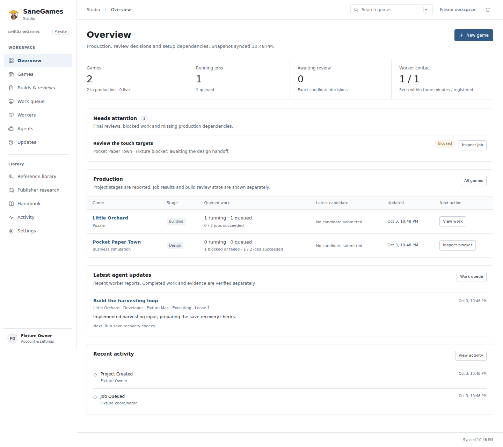

# Studio dashboard

The dashboard is the owner's production workspace. It answers four questions: which games are moving, what is blocking work, what the agents last reported, and which exact builds need a decision. Repository documentation and reference research support those tasks.

Preview from an offline browser fixture. Games, workers and activity are synthetic test records; the role/reference catalog is repository data. This is not a production activity screenshot.

## Visual direction

Use white backgrounds, charcoal text, subtle neutral separators, small corner radii and one restrained blue interaction color. Status colors have visible labels. Use system Helvetica/Arial fonts without external font requests. Tables, compact lists and clear headings carry the hierarchy. Avoid promotional heroes, oversized statistics, decorative gradients, fictional trend charts and large collections of identical cards.

The supplied 60 × 60 mascot stays unchanged at `cloudflare/public/assets/studio-mascot.png`, SHA-256 `fb89b2cb3bc816419f8c86b82fc9750a9763087aaf9ece81acc077b0ca6bb239`. It is the favicon and a small studio identifier, not a repeated illustration.

## Information architecture

| Workspace | Question it answers | Useful action |
|---|---|---|
| Overview | What needs attention, what is moving, and what changed? | Open the specific candidate, failed assignment or game. |
| Games | Where is each game in production? | Search/filter the portfolio, open its workspace, or create a game with its repository. |
| Game workspace | What is the brief, work state, latest build and next step for this game? | Link source, queue the initial pipeline once, inspect updates, open builds and review evidence. |
| Builds & reviews | Which exact versions can I test or review? | Filter candidates; inspect Android/iOS artifacts, source identity and evidence; give an exact-build decision. |
| Work queue | What is assigned, executing, blocked or finished? | Filter by game/role/status; inspect updates/results; queue a scoped assignment, retry eligible work or cancel it. |
| Workers | Which configured Macs have checked in? | Inspect last contact, supported roles and claimed assignments; open the setup guide. |
| Agents | Which role owns a responsibility? | Search departments and contracts; read the full prompt or assign a role. |
| Updates | Which released games have an update target? | Open the game or assign maintenance work. |
| Reference library / publisher research | What can inform an original game? | Inspect sources, shortlist and draft a distinct concept. |
| Handbook / activity / settings | How does the studio operate, what happened, and what is connected? | Read contracts, inspect recorded events and access account/export controls. |

## State and control rules

- Project creation can include an existing private-repository URL. It creates a record; it does not create a remote repository or start Claude.
- Initial production uses the existing durable, idempotent pipeline. Once present, the game links to that work instead of offering a misleading restart.
- An awaiting-review candidate can still have incomplete gates. Show exact reported evidence and retain the backend's approval checks.
- Agent progress is a worker-reported update with a timestamp and assignment identity. It cannot mark evidence as independently verified or approve a release.
- Heartbeat freshness means recent contact, not available model allowance or successful device/tool checks.
- Historical role tasks are reported milestones, separate from executing queue jobs.
- Review feedback and any follow-up assignment remain explicit records. A request for changes alone is not a running repair.
- Do not display estimated costs, model utilization, fabricated completion percentages or scheduled ETAs without a supported source.
- Empty, unavailable and stale states must be distinguishable. Filters need visible state and a clear way to reset.

## Verification and deployment

Run `npm test`, `node tests/browser_jobs.mjs --static` and `node tests/dashboard_layout.mjs --static`. Full browser fixtures require Playwright and Chromium; `CHROMIUM_PATH` selects the executable and `BROWSER_OUTPUT` saves test previews. Fixtures use synthetic owner/project/worker/activity data and actual role/reference catalog entries. They are not screenshots of production activity.

Follow [hosted setup](HOSTED_DASHBOARD.md) for deployment. Preserve the Durable Object identity, migration, Google account policy and release records. A source push or a passing workflow is not evidence that the Cloudflare hostname serves that revision. See [verification history](HOSTED_TESTING.md) for executed checks.
