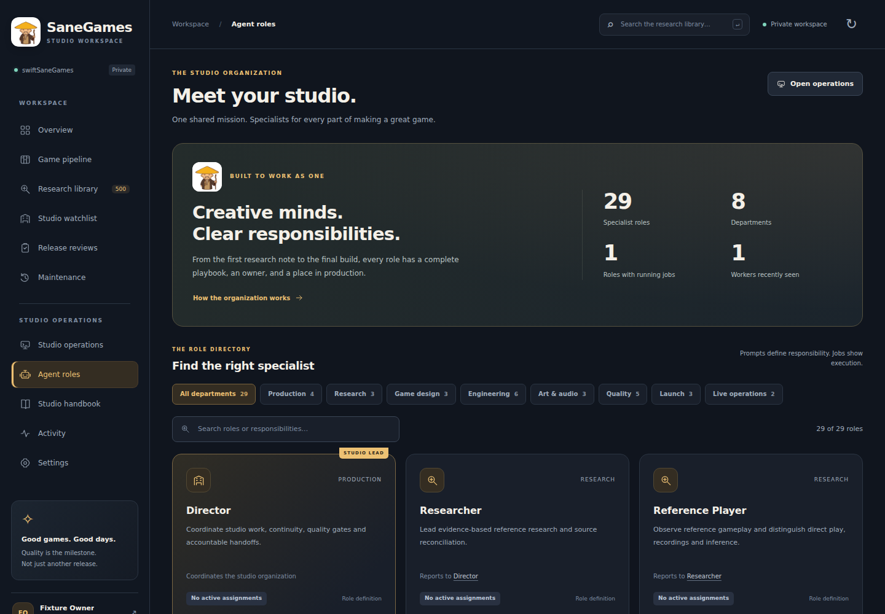

# Studio dashboard design

The dashboard uses one visual system across production, agents, research, release review, account access and sign-in. The redesign keeps the existing native Cloudflare application and its authentication/approval boundaries.

Preview generated from the browser fixture: project, job, worker and owner records are synthetic. The 29 role contracts and 500-reference catalog are the repository data. This is not a screenshot of production activity.

## Identity

The owner-supplied 60 × 60 PNG is stored unchanged at `cloudflare/public/assets/studio-mascot.png`. Its SHA-256 is `fb89b2cb3bc816419f8c86b82fc9750a9763087aaf9ece81acc077b0ca6bb239`. Dashboard, login and privacy pages reference it as their PNG favicon. The sidebar and studio headers reuse it at or below its native size. No new third-party image or font service is loaded.

Dark navy surfaces, warm cream text, honey-gold actions and teal status accents distinguish hierarchy and state. Visible labels accompany status colors. CSS includes keyboard focus, responsive layouts, and reduced-motion handling.

## Working views

- **Overview:** actual project and job counts, production stages, recent projects, attention items, worker contact and research entry.
- **Agent roles:** the full registry organized into eight departments, searchable responsibilities, reporting relationships, complete prompts, scoped assignment and role-filtered jobs.
- **Operations:** the existing dependency-aware assignment, retry, cancellation and evidence controls.
- **Research and reviews:** the existing catalogs and exact-build review workflow, restyled consistently.

Empty workspaces remain empty. Role definitions are not presented as connected workers, and heartbeat freshness does not claim completed work. Creating an assignment queues it; it does not approve a release.

## Verification

Run `npm test` for native routing, authentication, release and queue checks. `tests/native/branding.test.mjs` checks public PNG delivery, icon links and preservation of protected routes. Run `node tests/browser_jobs.mjs --static` and `node tests/dashboard_layout.mjs --static` for offline UI contracts. Both full browser fixtures use Playwright and a separately installed Chromium; pass `CHROMIUM_PATH` if needed. Set `BROWSER_OUTPUT` to a temporary folder when refreshing the layout previews. The redesign fixture checks department/search filtering, prompt reading, assignment selection, role-job navigation, route scroll reset, refresh scroll preservation, desktop/mobile overflow and console errors. Fixture projects and screenshots are synthetic test data, not production activity.

Deploy through the existing Cloudflare setup in `HOSTED_DASHBOARD.md`. A source push or a passing GitHub workflow alone is not evidence of a production deployment. Preserve the storage binding, object identity, Google configuration and release records.
